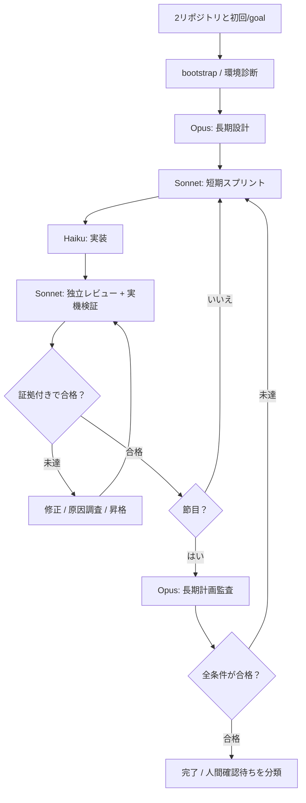

# 01 — 構成と環境別ブートストラップ

実装状況（2026-10-25）：この文書の役割分担を維持し、v0.1では`develop-sprint.js`へreview/fixを内包した。状態・証拠CLIは`bootstrap/state/record/context/doctor/verify.mjs`、共通処理は`scripts/lib/core.mjs`。実際のSchemaにはmission/backlog/current-task/contract/evidence/assessmentがある。実装上の判断と理由は[feasibility-report.md](feasibility-report.md)、実機未確認項目は[validation-results.md](validation-results.md)。

## 1. 方式

**外側：Claude Code `/goal` / 中央：Sonnet 5.5親セッション / 内側：Dynamic Workflow + 役割別サブエージェント / 独立：機械的品質ゲート**。

`/goal`の評価モデルは会話上に出た証拠を判断するが、独力でリポジトリを読み、テストを実行しない。したがって、最終ゲートの結果を実際のツールで取得し、会話にも出力する。Dynamic Workflowは工程の順序と分岐を保持し、1つの書き込みタスクの完了を待って次へ進める。



## 2. 共通リポジトリ：実装後の構造

```text
START.md
.claude-plugin/plugin.json
agents/{opus-architect,opus-auditor,sonnet-planner,sonnet-reviewer,sonnet-verifier,haiku-builder}.md
skills/{start-development,implement,review,verify,final-audit}/SKILL.md
workflows/{develop-sprint,review-and-fix,milestone-audit}.js
profiles/{web-app,game,backend}.md
scripts/{bootstrap,doctor,verify}.mjs
schemas/{mission,backlog,evidence}.schema.json
tests/{unit,integration,fixtures,smoke}/
docs/
```

実際にCodexが作る際、不要な重複や単なる空ファイルは増やさない。役割とモデルの期待値は正式定義を基準とする。ただしWorkflowスクリプトはファイルの`import()`や任意のモジュール読み込みができず、呼び出し単位のモデル指定がagent定義を上書きし得る。実行形式に合わせて指定し、**定義とWorkflowの役割・モデル対応が一致するかをテストする**。

## 3. 開発対象リポジトリ：生成・維持する状態

```text
.autodev/
  mission.md        # 元のユーザー要求（原文保全）と明示的な追記
  architecture.md   # Opusの長期計画・設計決定履歴
  backlog.json      # 機能ID、優先度、検証条件、状態、依存関係
  current-task.json # 現在のスプリント、実行者、再試行状態
  handoff.md        # 直近結果、既知問題、次の作業
  evidence/         # 必要な検証記録・レビュー・スクリーンショット
```

対象の既存`CLAUDE.md`、`.claude/`、`AGENTS.md`を破壊したり丸ごと置換したりしない。必要な設定の衝突は合成・比較して対処する。履歴や証拠の肥大化を防ぐため、全ログを無制限にGitへ格納せず、再現に必要な証拠とメタデータを残す。

## 4. モデルのデフォルト分担

| エージェント | モデル固定ID | 職責 |
| --- | --- | --- |
| architect | `claude-opus-5-5` | 初期の全体設計・受け入れ条件 |
| auditor | `claude-opus-5-5` | 節目の方向修正・最終監査 |
| planner | `claude-sonnet-5-5` | 直近の実装契約・依存整理 |
| builder | `claude-haiku-5-5` | 小さな実装・テスト・修正 |
| reviewer | `claude-sonnet-5-5` | 別コンテキストでのコードレビュー |
| verifier | `claude-sonnet-5-5` | 実機テスト・UI動作・結果整理 |

親セッションの推奨はSonnet 5.5。サブエージェント呼び出し時の`model`指定はfrontmatterより優先され得るため、実際に起動したモデルを`/tasks`等で検査し、想定と違えば警告を残す。アクセス不能なモデルへ黙って変更しない。複数作業を同一ディレクトリへ並列書き込みさせない。

`availableModels`制限・プロバイダ差・エージェント起動時のモデル上書きにより**指定モデルが別モデルへ置換されることがある**。実行モデルの確認は表示名の自己申告では済ませず、取得可能な実行ログ・task詳細・使用モデル情報に基づき記録する。必須の5.5モデルが代替されれば厳格なモデルルーティング試験はFAIL/UNVERIFIEDとし、代替実行の可否は明示する。

## 5. クラウド：主な利用モード

1. GitHubの開発対象と本リポジトリをClaude Codeクラウドセッションに追加。
2. 初期指示が`START.md`を明示的に読み、対象・共通リポジトリをそれぞれ特定。対象未特定のままファイルを変更しない。
3. 必須モデル、`/goal`、Dynamic Workflows、ファイルアクセス、依存ツールを`doctor`相当で診断。
4. **第1候補：共通リポジトリのワークフロースクリプトをWorkflowツールで直接起動**。スクリプトは読み取りを許可されたパスに存在する必要がある。`node workflows/*.js`で代用できるとは扱わない。クラウドではローカルプラグインが自動適用されないため、共通側のパスへの読取許可・Workflow起動権限・正常な`meta`を個別に実証する。
5. **第2候補：必要な最小ファイルを対象リポジトリの`.claude/`に冪等コピー**し、`.claude/workflows/`の標準発見規則とagentsの読み込みを調べる。新たに置いたagentsの再読み込みにはセッション再起動が必要な場合がある。初回中は明示的なモデル付きAgent呼び出し等にフォールバックできるか実証し、不可能な場合は「1回の指示だけでは準備不可」と正直に示す。
6. 作業状態を対象`.autodev/`に残す。

クラウド版の「2リポジトリ選択 = 自動的に共通側の全設定が適用される」とは想定しない。

### 起動時の実証契約

- 両方のGit remote URL・作業パス・ブランチ・worktreeを実測し、書き込み先が対象リポジトリであることを確定してから初期化する。共通側への書き込みを既定にしない。
- Claude CodeのWorkflowは**非同期**で動く。スクリプト自身にはshell/file API・`import()`がなく、実ファイル操作と検証はagentが行う。親セッションは結果を待ち、進行中の実装を完了と数えない。
- 起動承認は環境の許可モードに依存する。承認ダイアログが出た場合はその手動確認だけ残し、承認を自動化したと主張しない。
- `agent()`が`null`を返す・停滞再実行される場合を失敗として扱い、無視して後続ステージをPASSにしない。

## 6. ローカルCLI：第2の利用モード

対象を作業ディレクトリにし、`claude --model claude-sonnet-5-5 --add-dir /path/to/Claude-enhancement-system --plugin-dir /path/to/Claude-enhancement-system` を使う。

`--add-dir`だけでも追加先の一部skills/agents/commandsは発見するが、hooksやsettings、一般の`CLAUDE.md`がすべて自動で反映されるわけではない。プラグイン形式で配ることで読み込みを単純化する。クラウド互換性のため、プラグインの自動インストールを必須としない。

## 7. 実行の責任境界

- **共通側は読み取り中心**：共有ルールとスクリプトを勝手に更新しない。
- **対象側のみ書き込み**：コード、バックログ、証拠、引き継ぎ。
- **外部サービス**：プロジェクトが要求する場合のみ個別設定。標準動作に独自API・DB・有料ホスティングを要しない。
- **記録の原則**：セッションログは補助、対象リポジトリの元要求・計画・機械検査記録を一次情報とする。

## 8. 初期プロファイル

- `web-app`: 機能・画面遷移・ブラウザ操作・コンソール・レスポンシブ。
- `game`: 実際の起動・プレイ入力・進行・ルール・見た目・性能・破綻のない操作。
- `backend`: API・スキーマ・状態遷移・テスト・エラー・後方互換。

存在しない検証環境やツールは自動生成した「合格」で代替しない。`UNVERIFIED`とその理由を記録する。
